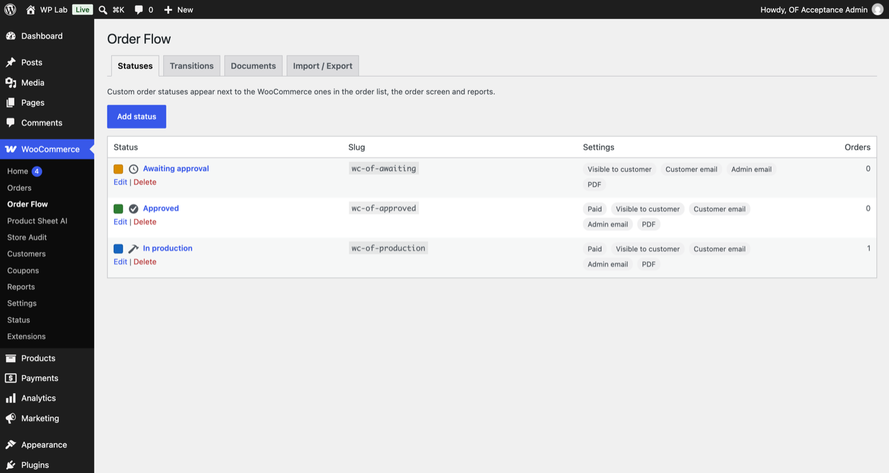
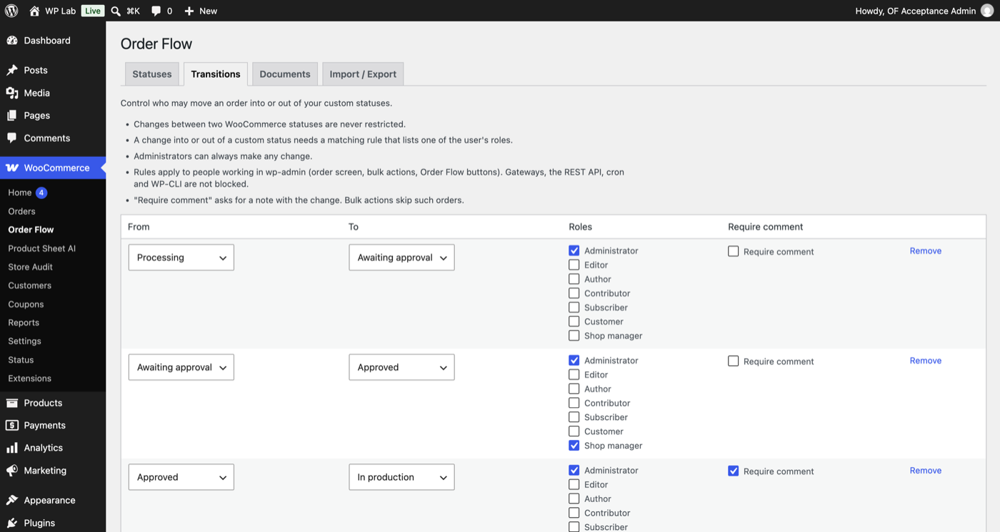
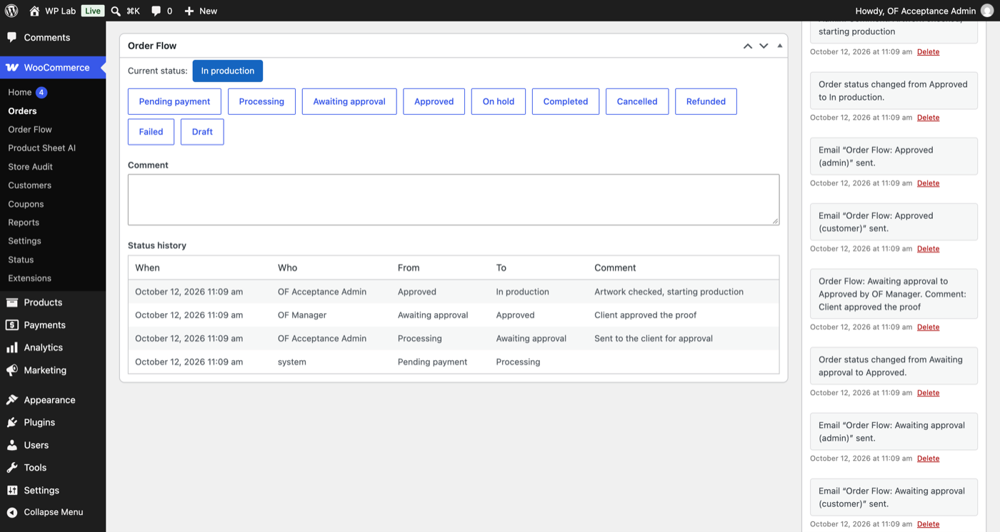
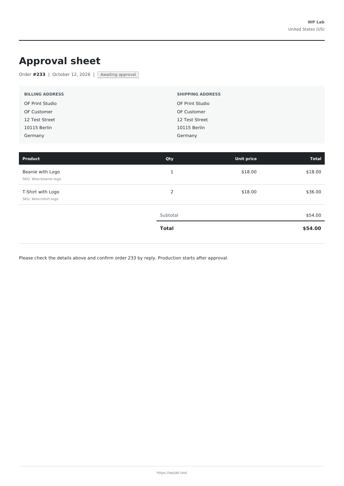

# Order Flow for WooCommerce: your order workflow, your statuses

Order Flow is a free WordPress plugin that lets a WooCommerce store run the workflow it really has. Add your own order statuses, say who may move an order from one status to another, and send the right email and PDF document at every step. Every change is recorded on the order: who, when, and why.

It is built for B2B stores, made-to-order shops and service businesses, where an order goes through approval, production or review before it ships. A customer places an order, a manager approves it, the customer gets an approval sheet by email, and nobody has to track it in a spreadsheet.

## What you get

- Your own statuses with label, color and icon, plus "count as paid", "reduce stock" and "show in My Account"
- Transition rules: who can move an order from one status to another, with an optional required comment
- History of every change on the order: who, when, from, to, comment
- A WooCommerce email per status for the customer, the admin or both, with placeholders for order number, name, total and more
- A PDF document per status (approval sheet, work order) with your logo and store details, downloadable by you and by the customer, and attachable to the email
- Import and export of the whole setup as JSON
- Safe deactivation: your orders are never lost
- HPOS compatible, no external services, no data leaves your site

## Need a custom order workflow? Tell me about it

If your process needs automatic transitions, approvals by several people or numbered documents, I can build it on top of Order Flow.

[Need a custom order workflow? Tell me about it](https://helpmybiz.org)

## Links

- Source: https://github.com/andrewrozumny/order-flow-for-woocommerce
- WordPress.org: https://wordpress.org/plugins/order-flow-for-woocommerce/
